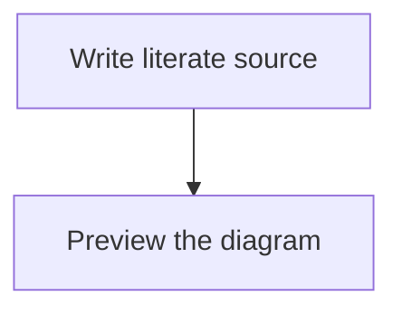

# **Literate Programming** for Visual Studio Code.

<a href="https://marketplace.visualstudio.com/items?itemName=jesterking.literate"></a>

This extension is inspired by the work done by [Physically Based Rendering: From
Theory To Implementation](http://www.pbr-book.org) by Matt Pharr, Wenzel Jakob,
and Greg Humphreys.

Initial extension activation is read-only: it discovers the project without
writing source or HTML. Saving inputs or running **Literate: Process** triggers
generation. Markdown preview supplies an editor preview. A headless CLI uses the
same generation engine, so VS Code is not required to regenerate or check a
project. Invalid projects produce diagnostics without replacing generated files.
Book publication is separate and always explicit.

Markdown previews receive Literate's document-scoped theme. The extension no
longer injects the legacy global `style.css`; the surrounding editor UI retains
its own theme.

## Features

Use the literate programming paradigm to write your programs. Documents that end
with the extension `.literate` will be processed.

Literate documents are written with regular Markdown. The CommonMark
specification is followed through the use of the markdown-it library. The code
fence has been extended to include fragment identifiers and their related
settings.

If a root `index.literate` exists, it is processed first, followed by documents
linked from it in link order. Remaining `.literate` documents are processed in
sorted path order; the index controls ordering, not exclusion.

The `index.literate` can contain a fence with `SETTINGS` on its info line. This
fence will be hidden from HTML, but hosts settings for controlling some aspects
of processing. Key=value pairs are given each on their own line. The recognized
keys for source/HTML processing are `template`, `authors`, and `theme`.
LaTeX export additionally reads the publication font settings described below.
The `template` should point to an
existing file containing an HTML template. The string `[CONTENT]` will be
replaced with the rendered HTML from the literate document. The string
`[AUTHORS]` will be replaced with `<meta />` tags for author information.
`[THEME]` inserts the selected theme's complete `<style>` element; put it in the
HTML template's head. Legacy templates without `[THEME]` receive the stylesheet
alongside `[CONTENT]`, so their content remains themed.

Code fragments can be created by adding `<<some identifying string>>=` to the
info line of a code fence, separated by a colon `:` after the language identifier.

Adding to existing fragments is done through `<<some identifying string>>=+`.

A top-level code fragment has a `.*` at the end of the identifying string:
`<<some identifying string.*>>=`. The top-level fragment should include a file
name followed by whitespace and ending in a dollar sign:

`<<some top level.*>>=./CodeFile.cs $`.

The file name is relative to the workspace folder. It can contain subfolders,
which will be automatically created during code generation .

After the file name you can specify extra settings, currently just
`template=filename`, where `filename` points to a file with a source template.
The string `[CODE]` in the source template will be replaced with the generated
source code.

Code fragments can reference other code fragments in code by using the code
fragment tag `<<some identifying string>>`. To emit literal delimiter text inside
a code fragment, escape the opening chevrons: `\<<some identifying string>>`.
The backslash is removed from the generated code and rendered code block.

If a fragment use is indented the indentation will be maintained for its
realization. This makes it suitable for use with languages like Python that use
indentation to denote scope.

The command `Literate: Process` (`literate.process`) processes all workspace
folders. Edits to referenced source/HTML templates also regenerate automatically;
external input create/change/delete events are debounced per workspace. Associate
`*.literate` files with Markdown to enable the editor providers.

## Language services inside fragments

Associate `*.literate` with **Markdown**, open a trusted local workspace, and
configure `literate.languageServers` in **User settings**. Hover over a code symbol
or type inside a named fragment: after a short pause, Literate automatically opens
suggestions when the server has matching results. **Ctrl+Space** remains available.
Fragment-name suggestions remain available inside unfinished `<<` tags. Language
services also include signature help, snippets and completion details, code
navigation, and mapped diagnostics.

Automatic completion is scoped to mapped fragment code, including template-backed
outputs. Identifier typing and the server's advertised trigger characters (such
as TypeScript's `.`) are supported without enabling Markdown-wide quick suggestions.
Literate does not trigger language suggestions in prose, fence headers, fragment
reference markers or ordinary `.md` files. Cursor/editor changes and Escape cancel
pending suggestions. Only the latest typing position is retained while a server
starts or finishes another request.

To keep completion manual, set `"literate.automaticCompletion": false` in User or
workspace settings. No changes to `[markdown].editor.quickSuggestions` are needed.
Automatic triggering handles single-character insertions in a single empty
selection; undo/redo, replacements and multi-character/multiline paste do not
trigger it. VS Code reports a one-character paste like an insertion, so it can
trigger suggestions too.

Each entry is keyed by a canonical VS Code language ID and contains an **absolute
server executable path**, optional `args`, optional `initializationOptions`, and
optional `configuration` returned to server configuration requests. For example,
a TypeScript entry uses `typescript` and a Zig entry uses `zig`. Fence aliases
`ts`/`js`/`tsx`/`jsx` normalize to their corresponding language IDs. Configure each
language ID you want to request services for; a TypeScript-family session receives
all TypeScript/JavaScript-family output overlays for import resolution.

Executable settings are global-only; workspace overrides are ignored. Literate
launches its own stdio LSP process per workspace/language on demand, without a
shell. It does not attach to another extension's private server, install tools,
or download servers. Installing a language extension alone is **not sufficient**:
its server must be available as a standalone stdio LSP executable. Configured
servers are trusted programs with normal access to the workspace, not sandboxed.
Remote extension hosts and non-file workspaces are not supported.

Verified server configurations:

- **TypeScript 7:** `TypeScriptTeam.native-preview` supplies a server executable
  inside its installation. The tested build uses `lib/tsc` with arguments
  `["--lsp", "--stdio"]`. `code --locate-extension TypeScriptTeam.native-preview`
  reports the extension directory. This is not the older JavaScript `tsc` command.
- **typescript-language-server:** a standalone alternative available through Mason,
  launched with `["--stdio"]`. Hover/completion on the actual template-backed
  `GrabbedStateList` source is verified. It can select the workspace TypeScript
  version: with TypeScript 4.9, our disk-absent alias/dependency fixture returned
  `any` where TypeScript 7 resolved types. Keep generated dependencies on disk if
  needed. Set `initializationOptions.disableAutomaticTypingAcquisition` to `true`
  to prevent this server's automatic typings installer from downloading packages.
- **Zig:** use the ZLS executable selected by `ziglang.vscode-zig`, with no
  arguments. Its **ZLS language server** output channel identifies the path after
  activation. Set `initializationOptions.zig_exe_path` to the absolute Zig compiler
  path when necessary. Tested with ZLS/Zig 0.16.0; TypeScript was 7.0.2.

Server paths may change when an owning extension updates. Failed sessions remain
stopped rather than repeatedly launching; consult **Literate Language Servers**
in the Output panel and run **Literate: Restart Language Servers** after fixing
configuration. Changing `literate.languageServers` also resets sessions. The
channel reports successful startup, projection failures (including missing
templates and expansion limits), and categorized snapshot/server errors without
printing source contents or server protocol payloads.

The server sees assembled outputs at their intended `file:` URIs, populated from
current literate buffers. Requests neither save nor generate files; ordinary
edit-triggered generation remains unchanged. Same-language generated dependencies
are synchronized too, even if their output files do not exist. Physical imports
and project configuration are read by the server. Source templates are included,
with unsaved template buffers taking precedence over disk. Only the code inserted
at `[CODE]` has fragment mappings; wrapper text cannot be edited through a fragment.

Supported services (subject to the server's advertised capabilities):
- **Signature help:** parameter hints in mapped code, including server-advertised
  trigger/retrigger characters and parameter labels/documentation.
- **Completion:** plain text and snippets, incomplete lists with follow-up
  requests, and lazy completion resolution. Resolve copies **documentation and
  detail only**; it cannot change the accepted insertion, range or label.
- **Navigation:** definition, type definition, implementation and references.
  Generated-output targets map back to literate sources; validated ordinary local
  `file:` targets can open directly. Repeated results are deduplicated.
- **Diagnostics:** server problems map into literate sources in the separate
  `literate-language` collection, without replacing Literate's fragment/engine
  diagnostics. The resource-scoped `literate.languageDiagnostics` setting defaults
  to `true`; set it to `false` for a resource or workspace to disable language
  diagnostics without disabling the other services. Open/edit activity can start
  configured servers for background diagnostics. Pull diagnostics are preferred
  when advertised; otherwise push diagnostics are used.
- **Code actions:** explicitly invoked edit-only quick fixes and refactorings whose
  complete edit set maps into the current, uniquely expanded fragment. VS Code
  presents the action for review and applies it only after the user selects it.

Boundaries:
- Only named fragments reachable from a valid output receive services. Invalid
  fragment graphs, missing templates, and expansion-limit violations return no
  results. A request in a repeatedly used fragment or repeated `[CODE]` slot uses
  its first deterministic expansion. Mutating code actions are stricter and reject
  repeatedly expanded fragments because one source edit would affect every use.
- Completion replacement ranges must be single-line and remain within the active
  source mapping. Commands and auxiliary edits/auto-imports are not applied,
  including during resolve. Snippets do not grant access to other source ranges.
- Hover, completion and signature Markdown is untrusted; unsafe mapped ranges
  are rejected. UTF-16 positions and document open/change/close synchronization
  are required from servers.
- Unmapped diagnostics (for example, template-wrapper-only ranges) are omitted,
  not attached to an invented source location. Diagnostic `relatedInformation`
  is omitted. Matching versions and captured input freshness reject known stale
  reports; **unversioned push freshness is best effort**, since a late report
  cannot reliably be correlated with the source version that produced it.
- Code actions must be explicit, eager `WorkspaceEdit.changes` replies for one
  generated URI. Every non-overlapping edit must map into the current fragment.
  Commands, disabled or malformed actions, partial mappings, cross-file edits,
  file operations, annotations, snippets, repeated expansions and oversized edits
  are rejected as a whole. Only `quickfix` and `refactor` kinds are accepted.
- Interactive requests are serialized; overlapping requests can return no result.
  Cancelled or stale results are discarded. Language-server rename and formatting
  are **not forwarded**. Existing fragment-name completion, definition/reference
  navigation, rename and fragment code actions are unchanged.
- General server filesystem-watch registration is not forwarded. Restart servers
  if external dependency or project-configuration changes are not picked up.

## Exploring fragment references

Preview and generated HTML retain ordinary fragment-navigation links and add
separate disclosure buttons for local fragment uses. Opening a disclosure shows
the family's contributions without eagerly expanding the whole reference graph.
Nested references can be explored in turn; cycles and depth limits stop locally.
Without JavaScript, ordinary links remain usable.

Exploration is bounded: a 1 MiB serialized payload, eight nested layers, 256 KiB
of conservatively accounted panel content per document, 200 open panels, and at
most 200 unique contributions and 4096 segments per requested panel. Oversized
views are rejected before their DOM is allocated, rather than silently truncated.
Links from payloads accept only matching anchors, validated relative HTML paths,
or narrowly shaped Literate editor capabilities. HTTPS destinations are reused
only from an existing same-target baseline link. The extension independently
validates editor capabilities; payloads cannot supply arbitrary commands.

## Document themes

All **70 HErmonica built-in palettes** are available locally, with their original
case-sensitive names. Set the project theme in the root `index.literate`:

````markdown
```SETTINGS
theme=rosepine-dawn
```
````

`rosepine-dawn` is the default when omitted. Other choices include `rosepine`,
`hermonica`, `catppuccin`, `gruvbox`, `gruvbox_light`, `nord`, `github_light`,
`tokyonight`, and `vscode_dark`. See the [theme catalogue](literate/themes.literate)
for the full set. Hyphens and underscores are significant.

The selection applies project-wide to prose, code fragments, syntax highlighting,
tables, and Mermaid diagrams in both preview and default generated HTML. It is
independent of VS Code's light/dark selection. Preview prefers unsaved root settings;
CLI generation reads disk. Standalone Markdown previews use the default.
Unknown or empty theme names produce a diagnostic and prevent output writes;
preview falls back to the default while the setting is invalid. Chapter-local
SETTINGS do not override the root theme. Saved input changes outside VS Code refresh the cached project state through
filesystem watchers; **Literate: Process** remains available for an explicit refresh.

Generated pages embed their CSS, so nested chapters no longer depend on a relative
`style.css` path. Custom templates control their own Mermaid initialization; the
`[THEME]` placeholder supplies document CSS, not scripts. Palette provenance and
MIT attribution are preserved in [THIRD_PARTY_NOTICES.md](THIRD_PARTY_NOTICES.md).

## Mermaid diagrams in Markdown preview

This version requires **VS Code 1.96 or newer** for the bundled renderer's modern
browser APIs. Literate bundles **Mermaid 12.0.0** locally. No Mermaid extension, account, or CDN
is required to preview ordinary Mermaid fences:

````markdown

````

Associate `*.literate` with Markdown, then use **Markdown: Open Preview to the Side**.
Diagrams update with the document and follow the project's selected palette. Syntax
errors appear beside the original diagram source without stopping other diagrams.
Named literate fragments with the Mermaid language remain code, not diagrams.

The preview uses strict rendering, disables callbacks, and limits diagrams to
50,000 characters and 500 edges. Mermaid directives and YAML frontmatter are
currently rejected to keep rendering configuration controlled by Literate.
Literate handles its own diagram containers; other Mermaid extensions are optional.

This support is for the **VS Code preview**. Generated HTML still uses the existing
browser/CDN rendering path; offline, embedded-SVG HTML export is not implemented.

## Command-line development

From a checkout, use Node.js 22 LTS (>=22.12) and the pinned Yarn version through Corepack:

```sh
yarn install --immutable
yarn literate generate
yarn literate check
yarn test
```

`generate` updates source and HTML; `check` reports missing or stale outputs without
writing. An optional final argument selects another project root. The CLI reads
saved files, whereas the extension uses open buffers; do not run both generators
concurrently against the same project.

After `yarn build:cli`, the direct executable is `node out/cli-entry.js`
(for example, `node out/cli-entry.js check`). `out/cli.js` is a library module,
not the executable entry point.

See [CONTRIBUTING.md](CONTRIBUTING.md) and the
[development chapter](literate/development.literate) for the self-hosting workflow.
Edit the literate chapters rather than their generated TypeScript.

## M5: integrated VS Code publication

Use the Command Palette's **Literate: Export LaTeX** (`literate.exportLatex`) or
**Literate: Export PDF** (`literate.exportPdf`). M5 integrates the explicit M1–M4
publication pipeline; saves and ordinary generation still never export a book.

### Configure local tools

Publication requires a **trusted, local desktop workspace with `file:` folders
on POSIX**. Remote extension hosts/workspaces, web, virtual filesystems and Windows
are rejected. Node, Pandoc, TeX, Chromium and the project must be on the same host.
This is trusted-input processing, not a TeX/Lua sandbox.

Configure these machine-scoped settings in **User settings**, not workspace
settings:

- `literate.publication.nodePath`: required explicit **absolute path to external
  Node.js >=22.12**. Electron (including VS Code's runtime) is not supported;
  there is no PATH-based Node discovery. Workspace executable overrides are ignored.
- `literate.publication.browserPath`: optional explicit **absolute path** to an
  installed sandbox-capable Chromium. Required for Mermaid publication; omit for
  books without diagrams. No browser discovery or downloader is provided.
- `literate.publication.fontManifest`: optional safe **root-relative** JSON path,
  such as `fonts.json`, resolved inside the selected workspace folder. See
  [portable fonts](#opt-in-portable-fonts) for its format and licensing obligations.

Pandoc must be on PATH; PDF also requires the local TeX tools and packages listed
under [M4](#m4-explicit-pdf-book-compilation). Installed packages need no checkout,
`node_modules`, or build tools: publication ships three self-contained runtime
files (`publication-helper.cjs`, `publication-mermaid-worker.mjs`, and
`publication-mermaid-browser.js`). External tools and fonts are not bundled or
installed automatically.

### Export a captured book

1. The active editor's workspace folder is selected when available; otherwise
   choose a workspace folder in the picker.
2. Pick the page size: `a4`, `a5`, `letter`, or `legal`.
3. Enter margins in **top,outer,bottom,inner** order, in millimetres, for example
   `18,20,22,14`. The inner margin is the binding edge: left on odd right-hand pages
   and right on even left-hand pages. The outer margin exchanges those physical edges.
   Each must be 5–50 mm and leave at least an 80 × 100 mm text area.
4. Choose a `.tex` or `.pdf` save path **inside the selected root**. The Save dialog
   selects the output, not a request to save your input documents. Unsafe paths,
   symlinks and protected input aliases are rejected.

Only successful choices are remembered, separately per workspace root and export
kind. Defaults are A4, `20,20,20,20`, and `publication.tex` or `publication.pdf`.
Prompt cancellation starts no helper and writes nothing.

After the prompts and on entering the shared queue, publication captures a fresh
snapshot of the selected project's `.literate` documents. Open file-backed buffers
supply their current text, including unsaved edits, new files not yet on disk and
empty documents. It never calls `saveAll`; untitled/virtual documents are not
project inputs. Later edits do not change that captured export. Binary assets and
font files are read from disk only, not from editor buffers.

Publication and source/HTML generation use one serialized extension queue; a
second publication is rejected while prompts, queueing, capture, or helper work is
in progress. The guard is released before the optional **Open Output** notification,
so leaving that notification visible does not block another export. Initial activation is
read-only—no source/HTML output until a save or explicit processing. Invalid
source/HTML generation templates do not disable publication. This queue does not
coordinate separate CLI processes or other VS Code instances: do not run those
writers concurrently.

### Progress, cancellation and results

The notification provides cancellable progress. Cancellation or revocation before
commit aborts publication and rolls back staged changes, preserving existing
outputs. A cancellation arriving after commit does not undo the output: committed
success is reported truthfully. Removing the selected folder or disposing the
extension cancels active work and suppresses subsequent remember/open actions;
any already committed output remains published.

The helper has a **10-minute execution deadline**, after which the extension sends
`SIGTERM` for graceful transaction cleanup. Cancellation uses the same cooperative
path. If cleanup has not acknowledged cancellation after 30 seconds, progress and
the output channel report that publication remains locked. The queue is retained
until the helper exits—there is **no force kill or hard termination guarantee**.

The **Literate Publication** output channel records results, errors and compiler
warnings. Success offers **Open Output**, which opens the exported file. Success
with warnings is not a clean-typography guarantee; inspect the channel and PDF.
See [M5 acceptance](CONTRIBUTING.md#m5-integrated-publication-acceptance) for the
headless, real-host and isolated-package evidence and its limits.

## M6: terms, explanatory notes and indexes

M6 is complete with the approved explicit author syntax. It works through the
existing `latex`/`pdf` CLI and VS Code publication commands, generated HTML and
Markdown preview; there is no separate annotation export command. M7 is not
claimed complete. See [M6 acceptance](CONTRIBUTING.md#m6-annotation-acceptance)
for recorded tests, real PDFs and native-host evidence.

### Author syntax and semantics

````markdown
```TERM transaction "Output transaction"
A transaction publishes related outputs together, or preserves the previous set.
```

See the [transaction contract](term:transaction).

```NOTE
This explanation belongs to this point in the prose.

- **Important:** publication is explicit.
- Use `check` before generating; see the [contract](term:transaction).
```
````

Fence headers are case-sensitive: `TERM key "Display title"` or `NOTE` without
arguments. A key matches ASCII `[A-Za-z][A-Za-z0-9_.:-]{0,99}` (1–100 characters).
The required title is a JSON-quoted string, at most **200 Unicode code points**;
an empty title is accepted. Trailing header whitespace is ignored. Markdown-it
controls fence boundaries. Both bodies allow paragraphs, ordered/unordered lists,
emphasis, strong emphasis, inline code, links and line breaks. Raw HTML, images,
headings, blockquotes, tables, strikethrough, indented/fenced code and nested
TERM/NOTE/Mermaid fences are rejected. Inline code is allowed; code blocks are not.
Raw author TeX is not an escape hatch into the rail.

Only explicit `[label](term:key)` links are term uses. Keys are exact and
case-sensitive; destinations are percent-decoded once. There is no heuristic
matching of words, labels or display titles. Different keys may share a title.
Malformed headers/bodies report `annotation-header` / `annotation-body`;
duplicate definitions report `annotation-duplicate`, and unresolved uses report
`annotation-missing` or `annotation-ambiguous`, with source locations. These
errors block publication. Tolerant preview leaves unresolved links inert rather
than guessing. **Term links in headings intentionally fail export** with
`annotation-heading`: moving headings into contents/running matter would replay
rail markers. Put the link in prose below the heading instead.

These are four distinct things:

- A **TERM definition** remains in the prose with its title and definition body.
- The **Term index** links to definitions; it does not relocate their bodies.
- A **page-local term lookup** in the PDF rail contains the title and final
  definition page, not the definition body. Repeated uses of one key on the same
  physical page share one entry; a use on another page gets another entry.
  Prose link labels retain their explicit wording and linked definition-page suffix.
- A **NOTE** is a numbered explanation in source encounter order, with a marker
  in print prose and its controlled body in the rail. It is not a term definition
  or a term lookup. Links inside annotation bodies still resolve, but do not
  recursively create rail markers.

Annotated projects get both **Term index** and **Fragment index**. Print indexes
link to term definitions and fragment contribution pages. HTML/preview indexes
also link to definitions, additions and reference sites, and appear only at the
root (`index.literate`, or the first document if absent), not on every chapter.
Screen TERM sections and numbered NOTE asides remain in document flow; screens
have no physical-page rail. Preview uses the existing semantic navigation route,
including current unsaved canonical documents. Projects without TERM/NOTE
annotations retain their previous output and geometry: no new indexes or rail.

### Print geometry and failure policy

Annotated books reserve a **25 mm outer rail plus a 5 mm gap**. It appears on the
right of odd pages and the left of even mirrored pages. The requested outer page
margin is preserved beyond the rail: the body moves inward by **30 mm** (internally
the one-sided right or mirrored outer margin increases by 30 mm). The reduced body must still be at least **80 × 100 mm**.

- A5 with default 20 mm margins leaves `148 - 20 - 20 - 30 = 78 mm`: rejected.
- A5 with top/right/bottom/left **18/16/22/20 mm** leaves an **82 × 170 mm** body:
  valid geometry. Use the asymmetric example under PDF/LaTeX export below.
- Unannotated books do not reserve the extra 30 mm.

Placement uses actual shipped page positions, not estimated source positions.
PDF publication requires both reference convergence and a stable `book.litrail`
placement certificate. Entries stay on their reference page without overlap;
there is no split, shrink, spill-to-another-page or other fallback. Stable vertical
or horizontal rail overflow fails publication, as does non-convergence, preserving
the previous PDF. A valid page size alone does not guarantee that its notes fit.

Export allows at most **1,000 terms and 1,000 notes**. Each source annotation body
and each controlled rail text value is limited to **131,072 UTF-16 code units**;
aggregate source/declaration and rendered declaration budgets are **2,097,152
code units**. These are the implementation's nominal “128 KiB” / “2 MiB” limits,
measured by JavaScript string length, **not UTF-8 byte limits**. Encoded identifiers
also consume declaration budgets. The rail additionally bounds use markers at
10,000; exceeding a limit fails rather than truncating content.

## M4: explicit PDF book compilation

M4 is finished: compile a supported, **trusted** literate project explicitly with
the CLI (omit the root to use the current directory):

```sh
yarn literate pdf path/to/project --output books/book.pdf --paper a4 --margin 20mm --json
```

The `.pdf` destination is relative to the selected project root, not the working
directory; absolute paths and paths outside the root are rejected. `pdf` shares
`latex` options: `--paper a4|a5|letter|legal`, `--margin`, `--margin-top`,
`--margin-right`, `--margin-bottom`, `--margin-left`, `--margin-inner`,
`--margin-outer`, `--font-manifest`, `--browser`, and `--json`. Geometry defaults
and bounds are described below.
Arguments take separate values. `--keep-build` is **PDF-only**. For example:

```sh
yarn literate pdf path/to/project --output books/book.pdf --paper a5 \
  --margin 20mm --margin-top 18mm --margin-outer 20mm --margin-bottom 22mm \
  --margin-inner 14mm --font-manifest fonts.json \
  --browser /usr/bin/chromium-browser --keep-build --json
```

Omit `--browser` for books without Mermaid; diagrams require an explicitly
selected installed, sandbox-capable Chromium as described under M3. Portable
fonts are opt-in; otherwise the configured families must be installed.

**Prerequisites:** Pandoc, `latexmk`, LuaLaTeX (`lualatex`), and `kpsewhich` on PATH,
plus KOMA-Script (`scrbook.cls`) and the TeX packages `fontspec`, `geometry`,
`fvextra`, `needspace`, `xcolor`, `microtype`, `amssymb`, `amsmath`, `graphicx`,
`ulem`, and `hyperref`. Nothing downloads or installs tools, browsers, fonts, or
packages. The default compiler is **POSIX-only** because process-tree termination
uses POSIX process groups; `.tex` export remains available without this compiler.
Font availability is checked by `fontspec` at the start of compilation, not by the
package preflight.

Compilation uses a private temporary stage and private TeX caches, with a fixed
`book.tex` entry regardless of the requested PDF name. Both the `latexmk` version
preflight and build use `-norc`, so latexmk rc files are ignored. Shell escape is
disabled, but this is **not a TeX/Lua sandbox: trusted inputs only**. Each preflight
process has a 15-second timeout; the build has a 180-second deadline and
`max_repeat = 5`. Process output and the compiler log are bounded at 4 MiB; the
PDF is bounded at 64 MiB. Publication requires reference convergence: genuine
final-log undefined-reference/citation or rerun warnings and exhausted passes
fail the build, rather than matching similar words in ordinary document text.

Only the requested PDF is published—no TeX, logs, auxiliary files, font/image
companions, tangled source, or HTML. Precommit failures or cancellation preserve
the original PDF. `SIGINT`, `SIGTERM`, and `SIGHUP` are handled throughout the
compiler and PDF CLI lifetime, with transaction cancellation checkpoints through
commit. A signal after commit does not undo successful publication or interrupt
its cleanup. Do not run concurrent writers.

Normally the private build is removed on success or failure. `--keep-build`
retains it on success or compilation failure and reports its path in
`publication.buildDirectory` (no directory exists for errors before staging).
The caller owns cleanup: retained TeX, logs, caches, fonts and assets may contain
sensitive material and licensed files. `publication.warnings` is an array of
deduplicated final compiler warnings, including missing glyphs and overfull boxes;
JSON mode reports them there, while human mode prints warnings and any retained
build path to stderr. Successful compilation does **not** imply clean typography.

`SOURCE_DATE_EPOCH` is honored via the inherited build environment, but PDF byte
determinism is not promised. The `latex ... --output books/book.tex` command is
unchanged and never compiles the book. Ordinary generation, activation and saves
do not compile PDFs; M5 adds the explicit extension commands described above.
See [M4 acceptance](CONTRIBUTING.md#m4-pdf-acceptance) for real CLI evidence and
`yarn test:pdf`.

## Explicit LaTeX book export

The CLI can export a supported literate project as a typeset book source:

```sh
yarn literate latex path/to/project --output books/book.tex --paper a4 --margin 20mm
```

Omit `path/to/project` to use the current directory. The `.tex` destination is
relative to the selected project root; absolute paths and paths outside it are
rejected. Paper choices are `a4`, `a5`, `letter`, and `legal`; defaults are A4 and
20 mm uniform margins. Physical `--margin-left` and `--margin-right` produce a
one-sided layout. For a bound book, use `--margin-inner` and `--margin-outer` to
produce mirrored two-sided pages; inner is the binding edge and outer is the
opposite edge on both odd and even pages. Do not combine the physical and mirrored
horizontal options. Top, bottom, and unspecified sides use `--margin`. Values
accept decimal millimetres only, each from 5 to 50 mm, leaving at least an
80 × 100 mm text area. For example:

```sh
yarn literate latex path/to/project --output books/book.tex --paper a5 \
  --margin 20mm --margin-top 18mm --margin-outer 20mm --margin-bottom 22mm \
  --margin-inner 14mm
```

Run
`yarn literate latex --help` for bounds, or add `--json` for machine-readable
results. Arguments use separate values rather than `--option=value`.

Export requires **Pandoc on PATH** (tested with 3.7.0.2), but never runs a TeX
engine. Mermaid additionally requires the explicit system browser described below;
exports without diagrams need no browser. It writes the requested LaTeX file,
local image/diagram companions and, only with `--font-manifest`, font/license
companions—not tangled source, HTML, or a compiled book PDF. Export is always
explicit: ordinary generation, extension activation and saves never launch the
publication browser. M5 supplies explicit extension export actions, not automatic
PDF compilation. Source, template, font and image inputs are protected
(including existing hard-link aliases), and all writes use the
same transaction/recovery mechanism as generation. Re-exporting identical content
leaves the output unchanged. Do not run concurrent writers.

The existing root `SETTINGS` `theme` selects from all 70 palettes; the default is
`rosepine-dawn`. Fonts default to Latin Modern Roman for prose, Monofur Nerd Font
for headings/references, and Lilex Nerd Font for code. Ligatures
remain enabled; copying code from PDF may change operators, so use original or
tangled source for executable code.

Select publication font roles in the root `index.literate` SETTINGS fence:

````markdown
```SETTINGS
theme=rosepine-dawn
font-body=Latin Modern Roman
font-heading=Monofur Nerd Font
font-code=Lilex Nerd Font
font-fragment=Monofur Nerd Font
font-note=Latin Modern Roman
font-size-body=11
font-size-code=10
font-size-diagram=16
font-size-rail=9
font-code-ligatures=on
```
````

These are the defaults. `font-fragment` covers both declarations and references;
`font-note` covers running matter, navigation, and reference page numbers. If
`font-note` is omitted it inherits the selected `font-body`. Font roles currently
apply to LaTeX only—not HTML or VS Code preview. Chapter-local settings cannot
change them. Use `font-code-ligatures=off` to disable contextual substitutions
(`calt`); font families may implement other ligatures through different features.
Lilex has native regular, bold, italic and bold-italic faces, so default code
comments use real italics rather than synthetic slant.

`font-size-body` accepts 8–24 TeX points, `font-size-code` accepts 6–24 TeX
points for block code, `font-size-diagram` accepts 8–48 CSS pixels for Mermaid
layout, and `font-size-rail` accepts 7–14 TeX points with approximately 1.2 line
spacing. Values are plain decimals with at most two fractional digits;
do not include units. Diagram vectors retain their natural print size and are
only reduced when they exceed the available width or page height.

Family names accept 1–100 ASCII letters, digits, spaces, dots, or hyphens,
starting with a letter or digit. Paths and TeX options are not accepted. Repeated
settings keep the last valid value, but any invalid occurrence blocks export.
Without `--font-manifest`, LaTeX export does not install a selected family or
verify that it is available; PDF compilation checks availability through `fontspec`.
Lilex and ordinary family overrides use native style lookup.
Only the exact legacy `D2CodingLigature Nerd Font Propo` code family retains its
automatic slant declaration. To keep that former default, explicitly set
`font-code=D2CodingLigature Nerd Font Propo`.

### Opt-in portable fonts

Add `--font-manifest publication-fonts.json` to `latex`. The manifest filename,
font paths, and license paths are all relative to the project root, **not** the
manifest directory. No Fonts directory or installed-font discovery occurs.
For example, a manifest entry looks like:

```json
{"version": 1, "families": {"Example Serif": {
  "regular": "fonts/serif-regular.otf", "bold": "fonts/serif-bold.otf",
  "italic": "fonts/serif-italic.otf", "boldItalic": "fonts/serif-bolditalic.otf",
  "licenses": ["fonts/OFL.txt"]
}}}
```

Map every distinct family selected by the root settings (including defaults and
inherited note fonts). Keys match family names exactly. Each entry requires all
four faces and one or more license paths; unknown fields, missing faces, unsafe
paths, missing/non-regular files, and symlink components are errors. Only `.ttf`
and `.otf` containers are supported. There is no automatic synthesis or fallback;
string mappings always use the supplied files without FakeSlant/FakeBold.
Mapping several string faces to one file does not synthesize styles.

For Lilex, map `LilexNerdFont-Regular.ttf`, `LilexNerdFont-Bold.ttf`,
`LilexNerdFont-Italic.ttf`, and `LilexNerdFont-BoldItalic.ttf` as plain strings under
`Lilex Nerd Font`; no synthesis is needed.

For families without italic faces, `italic` and `boldItalic` may instead explicitly
request slant. If you explicitly select D2 instead of Lilex, its family entry can use:

```json
"D2CodingLigature Nerd Font Propo": {
  "regular": "fonts/D2-Regular.ttf", "bold": "fonts/D2-Bold.ttf",
  "italic": {"file": "fonts/D2-Regular.ttf", "slant": 0.2},
  "boldItalic": {"file": "fonts/D2-Bold.ttf", "slant": 0.2},
  "licenses": ["fonts/D2-LICENSE.txt"]
}
```

Place that entry in the version-1 manifest's `families` object, alongside explicit
Latin Modern and Monofur mappings for the other default roles. Synthesis objects
require exactly `file` and `slant`; the latter must be a finite JSON number from
**0.01 through 0.3**, inclusive. Regular and bold remain string-only mappings.
The exporter copies each explicit file and emits `ItalicFeatures={FakeSlant=0.2}`
and/or `BoldItalicFeatures={FakeSlant=0.2}` only for opted-in faces. This preserves
italic D2 code comments without an automatic fallback. Bold-italic slant should
normally use the actual bold file: synthetic weight and arbitrary fontspec features
are not supported. The renderer revalidates paths and slants for API callers too.

All entries are validated and all declared paths are protected from output
collisions, including unselected entries; **only selected families are copied**.
Font and license bytes are preserved exactly. Companions receive deterministic
ASCII names under a `lit-fonts-<hash>` directory beside the `.tex`; raw input paths
never enter TeX. The book, fonts, and licenses use one recoverable transaction.
Re-export preserves unchanged files' mtimes. Old companions from previous selections
are not pruned: use a fresh export directory for a minimal distribution.

Move the `.tex` and its companion directory together. Compile from the `.tex`
directory (or use `latexmk -cd` as below). Providing licenses is an explicit author
responsibility: export does not check redistribution rights, parse font binaries,
verify family/face metadata, or guarantee glyph coverage. Font/package installation,
font collections, variable-font axes, and synthesis other than explicit italic-face
slant are outside this portable-font slice. M4 adds explicit PDF compilation above.
As with the existing filesystem transaction, concurrent changes to inputs are not
sandboxed; use a trusted,
quiescent project.

To compile later, install the named fonts (or export companions) and LuaLaTeX packages `fontspec`,
`geometry`, `fvextra`, `needspace`, `xcolor`, `microtype`, `amsmath`, `amssymb`,
`ulem`, `hyperref`, `graphicx`, and KOMA-Script (`scrbook`), then explicitly run, for example:

```sh
latexmk -cd -lualatex -interaction=nonstopmode -halt-on-error -no-shell-escape books/book.tex
```

Compile trusted projects only: disabling shell escape is not a complete TeX
sandbox. No fonts or packages are downloaded by the export command.

### Portable local illustrations

Put a PNG, JPEG or single-page PDF image in its own Markdown paragraph:

```markdown


> 
```

Paths are **relative to the source chapter**, unlike font-manifest paths. Parent
steps are allowed only within the project root. Remote URLs, absolute paths,
queries/fragments, malformed URI escaping, symlink components and non-regular
files are rejected. Inline images, formatted alt text, raw SVG and other formats
are explicitly unsupported. PDF inclusion uses page one; supply a single-page
figure. Extensions must match binary signatures, but export is not a full image
validator or a sanitizer: compile trusted assets only.

Identical bytes share a companion under `lit-assets-<hash>` beside the `.tex`.
Original names never enter TeX. All source aliases remain protected inputs.
The limits are 1024 image occurrences, 32 MiB per image, 128 MiB unique bytes and
4096 caption characters. Missing/invalid inputs and converter failures prevent
publication; text, font/license and image companions use one rollback transaction.
Old orphan companions are not automatically removed.

Move the **whole export directory** and compile there. The graphic fits both the
current list/quote width and the page text height minus a measured caption and
spacing budget, preserving aspect ratio. Every paper size and all four margins
participate through LaTeX geometry: A5 with top/right/bottom/left 18/16/22/20 mm
has a 112 × 170 mm body. A tall figure may move to a new page, leaving a preceding
heading behind. Captions leaving less than 24 pt for the graphic fail compilation.
Long unbreakable caption words can still cause TeX warnings, and extremely dense
figures may become unreadable when reduced; inspect compiler logs and the PDF.
No clipping or rasterization is added by the fitting code. An input PDF's own
CropBox still determines its visible content.

### M3: explicit Mermaid vector export

Ordinary Mermaid fences can become local SVG+PDF companions; LaTeX includes the
PDF using the same width/height fitting as local illustrations. For example:

```sh
yarn literate latex path/to/project --output books/book.tex \
  --browser /usr/bin/chromium-browser
```

Supply an **absolute path to an installed, sandbox-capable system Chromium**.
The verified path is `/usr/bin/chromium-browser`; `puppeteer-core` neither downloads
nor discovers a browser. Install the checkout's development dependencies and use
**Node >=22.12 on POSIX**; Windows is rejected because worker/browser process-tree
cleanup relies on POSIX process groups. Without `--browser`, Mermaid export fails
explicitly; pre-rendered local PNG/JPEG/PDF figures remain a browser-free option.

The publication bundle includes the full pinned **Mermaid 12.0.0** families,
registering **ZenUML 1.0.1** and **tidy-tree 1.0.1**, with no family allowlist.
Rendering uses the selected palette and system **sans-serif** fonts, separate from
book font roles and `--font-manifest`. Browser/font differences can affect layout;
not every theme/family configuration has been exhaustively verified.

Remote assets, image/icon resources, directives/frontmatter, authored HTML/CSS,
and interactions are blocked. Double-quote labels containing command words such
as `style`, `classDef`, `linkStyle`, `click`, `link` or `links` (for example,
`A["click to continue"]`): quoted text and comments are masked for the keyword
scan, not exempted from the other safety checks. Limits are 128 unique diagrams,
50,000 source characters each, Mermaid's 500-edge cap, 16,384 px per side and
16 million pixels of geometry; artifacts are capped at 4 MiB SVG, 16 MiB PDF and
32 MiB combined per batch. The worker has a 120-second batch deadline, 15-second
browser-operation timeouts and a 64 KiB log cap.

Generated SVG+PDF companions join the same rollback transaction as TeX, local
images and optional fonts/licenses. Move the whole export directory to compile;
**raw local SVG input remains unsupported**. See
[M3 acceptance](CONTRIBUTING.md#m3-mermaid-acceptance) for fixture and security
evidence, including full-book compilation with remaining typography issues.

### Heading destinations and links

Publication supports `[local](#heading)`, `[chapter](chapter.literate#heading)`
and the existing `[HTML alias](chapter.html#heading)` convention. Whole-document
links still work. Paths resolve relative to the source document, must stay inside
the project, and must name an included document. Percent-encoded paths/fragments
are decoded once; local queries, empty fragments, malformed escapes and unsafe
URL forms are rejected. HTTP/HTTPS/mailto links retain their external semantics.

Heading slugs use **visible parsed inline text** (including code spans and link
labels), not formatting delimiters or link destinations:

- Normalize Unicode to NFC and lowercase without locale-specific rules.
- Keep Unicode letters, marks, numbers, whitespace, hyphens and underscores;
  remove other punctuation/symbols. Trim and collapse whitespace to `-`.
- Normalize the final slug to NFC again before duplicate grouping and ID encoding:
  lowercasing or removing punctuation can create new composable sequences.
- Use `section` if the result is empty. Thus `# *Café* and \`x_y\`` becomes
  `café-and-x_y`; fragments are case-sensitive but NFC-normalized.
- Reserve all natural slugs in a document. A unique heading keeps its slug.
  Duplicate groups assign **every occurrence** numbered slugs (`foo-1`, `foo-2`,
  …), skipping reserved/allocated names. With two `Foo` headings and a literal
  `Foo-1`, use `#foo-2` and `#foo-3` for the duplicates, `#foo-1` for the literal.
  An unnumbered `#foo` is ambiguous and reports the available alternatives.

Opaque Pandoc heading IDs encode the canonical document path and allocated slug
in a separate collision-safe namespace. Line offsets, chapter order and unrelated
headings do not change them. Renaming paths/headings or adding colliding titles
can change IDs; duplicate ordinals follow source order, not edit-stable author IDs.
Forward links, setext headings and headings inside lists/quotes are supported
without flattening containers. Titles and labels stay escaped Pandoc data.

**Compatibility:** generated HTML currently emits plain Markdown-it headings
without IDs. The extension leaves heading IDs to VS Code's preview parser and
has no local slug implementation. Publication uses familiar lowercase/hyphen
slugs where practical, but does not promise exact host-preview punctuation or
duplicate behavior. In particular it rejects ambiguous duplicate links instead
of silently selecting the first. This slice does not change HTML/preview output
or add explicit `{#id}` syntax.

Missing documents (`missing-publication-document`), missing headings
(`missing-publication-heading`), ambiguous headings
(`ambiguous-publication-heading`) and unsupported URL forms
(`unsupported-publication-link`) report source locations **before conversion**.

**Current limits:** inline/unsupported images, tables and raw author tokens produce
diagnostics rather than disappearing. Missing fragments and cycles also block
export. Missing tools, browser/conversion failures and publication diagnostics
leave existing output untouched. Full-book compilation is not a clean-typography
guarantee; inspect compiler logs and the resulting PDF.

### M1 scope and screen compatibility

Historically, M1 provided explicit CLI export of the supported prose/fragment
subset to a portable LaTeX book, with optional licensed font companions. Its
sign-off excluded whole-repository Mermaid export (now covered separately by M3)
and compilation on a machine without the documented fonts/packages.
See the [criterion-by-criterion acceptance review](CONTRIBUTING.md#m1-acceptance-review)
for evidence and remaining limitations.

Fragment families have collision-safe `f-` targets; individual accepted definitions
and additions have distinct `c-` targets. IDs encode exact names as fixed-width
UTF-16 hex, with canonical document path and a one-based per-family/document
ordinal for contributions. Prose shifts and unrelated insertions preserve them;
renames, moves and insertions into the same family can change contribution IDs.
These are logical identities, not user-editable slugs. LaTeX destination names
encode the logical target again with a `lit-` prefix.

### M2: semantic HTML and preview navigation

HTML and preview now render definitions and uses from the same publication model
as LaTeX. Definition labels and genuine uses link to the family's base; **Previous,
Base, and Next** controls navigate individual contributions when available.
Links are native, keyboard-focusable anchors with descriptive accessible names.
Generated HTML uses chapter-relative `.html#target` URLs and needs no navigation
JavaScript. Escaped `\<<literal>>` examples remain literal, never links.

**Associate `*.literate` with Markdown.** Same-document links use native logical-ID
anchors and stay in the preview. Cross-document fragment links open the source
editor at the current declaration through Literate's registered URI handler,
independently of `markdown.preview.openMarkdownLinks`. Ordinary Markdown links
retain the host's behavior; Literate does not change editor preferences.

Cross-document URLs are opaque session capabilities, resolved as complete
`vscode://jesterking.literate/navigate/<session>/<token>` URIs through
`env.asExternalUri` (using the host's URI scheme). Returned routing data is kept
unchanged. No command URLs, custom click script, socket or browser bridge is used.
Only accepted semantic targets in a **trusted, currently open workspace** get a
capability. The handler rediscovers current sources, overlays unsaved buffers,
validates the target and safe existing path, and calls `showTextDocument` on the
canonical document with an explicit selection. Navigation retains a clean disk
snapshot and rebuilds the current-buffer overlay after opening, so discarding
another input cannot leave its old unsaved text in the final model. It never falls
back to `#L` links, which can produce divergent buffers in VS Code 1.138.0.

Pending or failed URL resolution renders plain text; successful resolution requests
a preview refresh. Capabilities expire on extension disposal or workspace removal;
re-adding the same workspace can mint fresh links but never revives old tokens.
Missing/renamed targets and unsafe paths fail closed. Restricted Mode disables
cross-document fragment navigation, not local anchors. The cache retains at most
4,096 workspace/target entries, with at most 16 URL resolutions in flight;
additional targets remain text while that limit is reached.

External URLs can become invalid without notification. Successful URLs are cached
for **at most 60 seconds**; one expiry timer requests a refresh, and targets still
rendered renew through `asExternalUri` without changing their capability tokens.
Unused targets do not keep renewing. Failures remain text and may retry on a later
render after a **60-second cooldown** (refresh the preview to request that retry).
Removal/disposal cancels expiry work, and late results cannot revive removed entries.
This bounds recovery but cannot guarantee a URL stays valid during its cache lifetime.
`data-literate-target` preserves logical identity independently of the opaque URL.
A third-party fence renderer that ignores Markdown-it's highlight option may
suppress code-use links.

Preview rendering is synchronous and read-only. It overlays the current rendered
source and other open, unsaved buffers on the owning workspace's last discovered
snapshot. Empty buffers remove definitions immediately. Missing references remain
unlinked; unmatched stale tokens (including changed declaration settings) never
borrow old semantic ranges. Raw invalid source is checked before host text
normalization. Rendered root settings and semantics use the same source overlay,
and snapshot refresh notifications follow installation of the new destinations. Closed-file
changes become available after the existing filesystem refresh completes;
**Literate: Process** explicitly refreshes the snapshot after a read failure.
The save/output transaction workflow is unchanged.

Whole-block syntax highlighting preserves context across references. Both
`js: <<name>>=` and `js : <<name>>=` delegate normalized `js`. Preview also preserves
host aliases such as `jsonc`/`json5`, `tsx`/`typescriptreact`, and `py3`. The syntax
merge advances monotonically, and snapshot indexes avoid per-use model scans.
All 70 palettes,
ordinary fences, source-token maps and Mermaid handling remain in place.
Screen comments retain the existing hiding policy, but genuine references inside
comments remain visible and navigable. M2 deferred the fragment index; M6 now
adds it for annotated projects only. Heading-ID parity remains deferred; M2 did
not redesign the website or add Mermaid export assets.

Automated tests use the real engine and activated preview plugin, including
independent destination/label assertions, cached tokens, unsaved buffers, remote
snapshots, all palettes, linear merge work and real Pandoc target parity. A bounded
VS Code 1.138.0 acceptance test dispatched real browser Tab/Enter input, checked
native focus/outline and ARIA names, and verified local scrolling before and after
an unsaved source shift. On the **unmodified installed host**, cross-file navigation,
an unsaved destination edit and navigation again reused the **same canonical dirty
TextDocument**, selected the actual moved declaration, and retained exactly one
document identity. Real pointer input also passed. **Screen-reader behavior,
physical-keyboard interaction, minimum-version host acceptance and complete editor
scroll synchronization remain unverified.** See
[the M2 acceptance and manual checklist](CONTRIBUTING.md#m2-screen-acceptance).

Development validation: `LITERATE_TEST_PANDOC=1 yarn test` enables real Pandoc
integration tests. Add `LITERATE_TEST_PANDOC_LIFECYCLE=1` to exercise both
30-second converter deadlines on POSIX; ordinary tests skip these slow cases.
For opt-in real A4/A5 portable PDF acceptance, use `yarn test:publication
--font-manifest /path/to/font-project/fonts.json`; see
[the acceptance workflow and its limits](CONTRIBUTING.md#opt-in-portable-publication-acceptance).
It checks relocated, unmodified CLI exports and requires caller-supplied licensed
fonts, LuaLaTeX/latexmk and Poppler. It is not part of the normal test suite.

## Output transactions and recovery

CLI and editor generation stage the entire changed batch before replacing output
files. Originals remain in private `.literate-txn-*` directories until installation
finishes. If staging or installation fails, the writer restores originals and
removes newly installed files and empty directories it created. Unchanged files
are not rewritten; local permission bits are preserved for existing files.

If rollback itself fails, the error lists affected paths and recovery directories.
**Keep those directories:** their numbered `.backup` files may contain your
originals. Inspect them before manual recovery. A `committed, cleanup failed` error
means new outputs are installed but some temporary material could not be removed;
it is not an unsuccessful commit. CLI `written` statuses follow that distinction.

This is a rollback-capable batch, not a crash-durable database transaction. Readers
can observe intermediate renames, and power loss or process termination does not
trigger automatic recovery. Do not run concurrent writers. Remote-provider rename
semantics and metadata guarantees vary; see the
[transaction chapter](literate/output_transactions.literate) for the contract.

## Example and documentation

The HTML documentation generated from this repository `.literate` files can be
found here : https://jesterking.github.io/literate/ . Here creation of code fragments
is explained in more detail.

## Credits

Extension author: Nathan `jesterKing` Letwory
