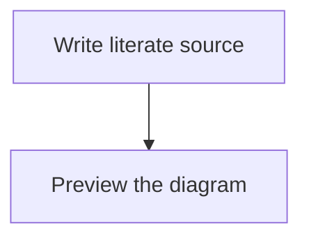

# **Literate Programming** for Visual Studio Code.

<a href="https://marketplace.visualstudio.com/items?itemName=jesterking.literate"></a>

This extension is inspired by the work done by [Physically Based Rendering: From
Theory To Implementation](http://www.pbr-book.org) by Matt Pharr, Wenzel Jakob,
and Greg Humphreys.

The extension generates HTML and code on activation and as literate documents
change. Markdown preview supplies an editor preview. A headless CLI uses the same
generation engine, so VS Code is not required to regenerate or check a project.
Invalid projects produce diagnostics without replacing generated files.

Markdown previews receive Literate's document-scoped theme. The extension no
longer injects the legacy global `style.css`; the surrounding editor UI retains
its own theme.

## Features

Use the literate programming paradigm to write your programs. Documents that end
with the extension `.literate` will be processed.

Literate documents are written with regular Markdown. The CommonMark
specification is followed through the use of the markdown-it library. The code
fence has been extended to include fragment identifiers and their related
settings.

If a root `index.literate` exists, it is processed first, followed by documents
linked from it in link order. Remaining `.literate` documents are processed in
sorted path order; the index controls ordering, not exclusion.

The `index.literate` can contain a fence with `SETTINGS` on its info line. This
fence will be hidden from HTML, but hosts settings for controlling some aspects
of processing. Key=value pairs are given each on their own line. The recognized
keys are `template`, `authors`, and `theme`. The `template` should point to an
existing file containing an HTML template. The string `[CONTENT]` will be
replaced with the rendered HTML from the literate document. The string
`[AUTHORS]` will be replaced with `<meta />` tags for author information.
`[THEME]` inserts the selected theme's complete `<style>` element; put it in the
HTML template's head. Legacy templates without `[THEME]` receive the stylesheet
alongside `[CONTENT]`, so their content remains themed.

Code fragments can be created by adding `<<some identifying string>>=` to the
info line of a code fence, separated by a colon `:` after the language identifier.

Adding to existing fragments is done through `<<some identifying string>>=+`.

A top-level code fragment has a `.*` at the end of the identifying string:
`<<some identifying string.*>>=`. The top-level fragment should include a file
name followed by whitespace and ending in a dollar sign:

`<<some top level.*>>=./CodeFile.cs $`.

The file name is relative to the workspace folder. It can contain subfolders,
which will be automatically created during code generation .

After the file name you can specify extra settings, currently just
`template=filename`, where `filename` points to a file with a source template.
The string `[CODE]` in the source template will be replaced with the generated
source code.

Code fragments can reference other code fragments in code by using the code
fragment tag `<<some identifying string>>`. To emit literal delimiter text inside
a code fragment, escape the opening chevrons: `\<<some identifying string>>`.
The backslash is removed from the generated code and rendered code block.

If a fragment use is indented the indentation will be maintained for its
realization. This makes it suitable for use with languages like Python that use
indentation to denote scope.

The command `Literate: Process` (`literate.process`) processes all workspace
folders. Edits to referenced source/HTML templates also regenerate automatically;
external input create/change/delete events are debounced per workspace. Associate
`*.literate` files with Markdown to enable the editor providers.

## Document themes

All **70 HErmonica built-in palettes** are available locally, with their original
case-sensitive names. Set the project theme in the root `index.literate`:

````markdown
```SETTINGS
theme=rosepine-dawn
```
````

`rosepine-dawn` is the default when omitted. Other choices include `rosepine`,
`hermonica`, `catppuccin`, `gruvbox`, `gruvbox_light`, `nord`, `github_light`,
`tokyonight`, and `vscode_dark`. See the [theme catalogue](literate/themes.literate)
for the full set. Hyphens and underscores are significant.

The selection applies project-wide to prose, code fragments, syntax highlighting,
tables, and Mermaid diagrams in both preview and default generated HTML. It is
independent of VS Code's light/dark selection. Preview prefers unsaved root settings;
CLI generation reads disk. Standalone Markdown previews use the default.
Unknown or empty theme names produce a diagnostic and prevent output writes;
preview falls back to the default while the setting is invalid. Chapter-local
SETTINGS do not override the root theme. Saved input changes outside VS Code refresh the cached project state through
filesystem watchers; **Literate: Process** remains available for an explicit refresh.

Generated pages embed their CSS, so nested chapters no longer depend on a relative
`style.css` path. Custom templates control their own Mermaid initialization; the
`[THEME]` placeholder supplies document CSS, not scripts. Palette provenance and
MIT attribution are preserved in [THIRD_PARTY_NOTICES.md](THIRD_PARTY_NOTICES.md).

## Mermaid diagrams in Markdown preview

This version requires **VS Code 1.96 or newer** for the bundled renderer's modern
browser APIs. Literate bundles **Mermaid 12.0.0** locally. No Mermaid extension, account, or CDN
is required to preview ordinary Mermaid fences:

````markdown

````

Associate `*.literate` with Markdown, then use **Markdown: Open Preview to the Side**.
Diagrams update with the document and follow the project's selected palette. Syntax
errors appear beside the original diagram source without stopping other diagrams.
Named literate fragments with the Mermaid language remain code, not diagrams.

The preview uses strict rendering, disables callbacks, and limits diagrams to
50,000 characters and 500 edges. Mermaid directives and YAML frontmatter are
currently rejected to keep rendering configuration controlled by Literate.
Literate handles its own diagram containers; other Mermaid extensions are optional.

This support is for the **VS Code preview**. Generated HTML still uses the existing
browser/CDN rendering path; offline, embedded-SVG HTML export is the next milestone.

## Command-line development

From a checkout, use Node.js 22 LTS and the pinned Yarn version through Corepack:

```sh
yarn install --immutable
yarn literate generate
yarn literate check
yarn test
```

`generate` updates source and HTML; `check` reports missing or stale outputs without
writing. An optional final argument selects another project root. The CLI reads
saved files, whereas the extension uses open buffers; do not run both generators
concurrently against the same project.

See [CONTRIBUTING.md](CONTRIBUTING.md) and the
[development chapter](literate/development.literate) for the self-hosting workflow.
Edit the literate chapters rather than their generated TypeScript.

## Explicit LaTeX book export

The CLI can export a supported literate project as a typeset book source:

```sh
yarn literate latex path/to/project --output books/book.tex --paper a4 --margin 20mm
```

Omit `path/to/project` to use the current directory. The `.tex` destination is
relative to the selected project root; absolute paths and paths outside it are
rejected. Paper choices are `a4`, `a5`, `letter`, and `legal`; defaults are A4 and
20 mm uniform margins. Margins currently accept decimal millimetres only. Run
`yarn literate latex --help` for bounds, or add `--json` for machine-readable
results. Arguments use separate values rather than `--option=value`.

Export requires **Pandoc on PATH** (tested with 3.7.0.2), but does not require or
run a TeX engine. It writes only the requested LaTeX file, not tangled source,
HTML, or PDF. Export is always explicit; extension activation and saves do not
publish books. Existing source/template paths are protected, and writes use the
same transaction/recovery mechanism as generation. Re-exporting identical content
leaves the output unchanged. Do not run concurrent writers.

The existing root `SETTINGS` `theme` selects from all 70 palettes; the default is
`rosepine-dawn`. Fonts default to Latin Modern Roman for prose, Monofur Nerd Font
for headings/references, and D2CodingLigature Nerd Font Propo for code. Ligatures
remain enabled; copying code from PDF may change operators, so use original or
tangled source for executable code. Font SETTINGS and font-file bundling are not
yet implemented, and export does not check whether these fonts are installed.

To compile later, install the named fonts and LuaLaTeX packages `fontspec`,
`geometry`, `fvextra`, `needspace`, `xcolor`, `microtype`, `amsmath`, `amssymb`,
`ulem`, `hyperref`, and KOMA-Script (`scrbook`), then explicitly run, for example:

```sh
latexmk -lualatex -interaction=nonstopmode -halt-on-error -no-shell-escape books/book.tex
```

Compile trusted projects only: disabling shell escape is not a complete TeX
sandbox. No fonts or packages are downloaded by the export command.

**Current limits:** Mermaid, images, tables, raw author tokens, and heading-fragment
links produce diagnostics rather than disappearing. Whole-document links to
included `.literate`/`.html` chapters work. Missing fragments and cycles also block
export. The repository's own book currently contains Mermaid diagrams, so it is
not yet a supported whole-book export. Missing tools, conversion failures, and
publication diagnostics leave existing output untouched.

Development validation: `LITERATE_TEST_PANDOC=1 yarn test` enables real Pandoc
integration tests. Add `LITERATE_TEST_PANDOC_LIFECYCLE=1` to exercise both
30-second converter deadlines on POSIX; ordinary tests skip these slow cases.

## Output transactions and recovery

CLI and editor generation stage the entire changed batch before replacing output
files. Originals remain in private `.literate-txn-*` directories until installation
finishes. If staging or installation fails, the writer restores originals and
removes newly installed files and empty directories it created. Unchanged files
are not rewritten; local permission bits are preserved for existing files.

If rollback itself fails, the error lists affected paths and recovery directories.
**Keep those directories:** their numbered `.backup` files may contain your
originals. Inspect them before manual recovery. A `committed, cleanup failed` error
means new outputs are installed but some temporary material could not be removed;
it is not an unsuccessful commit. CLI `written` statuses follow that distinction.

This is a rollback-capable batch, not a crash-durable database transaction. Readers
can observe intermediate renames, and power loss or process termination does not
trigger automatic recovery. Do not run concurrent writers. Remote-provider rename
semantics and metadata guarantees vary; see the
[transaction chapter](literate/output_transactions.literate) for the contract.

## Example and documentation

The HTML documentation generated from this repository `.literate` files can be
found here : https://jesterking.github.io/literate/ . Here creation of code fragments
is explained in more detail.

## Credits

Extension author: Nathan `jesterKing` Letwory
