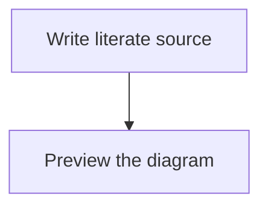

# **Literate Programming** for Visual Studio Code.

<a href="https://marketplace.visualstudio.com/items?itemName=jesterking.literate"></a>

This extension is inspired by the work done by [Physically Based Rendering: From
Theory To Implementation](http://www.pbr-book.org) by Matt Pharr, Wenzel Jakob,
and Greg Humphreys.

The extension generates HTML and code on activation and as literate documents
change. Markdown preview supplies an editor preview. A headless CLI uses the same
generation engine, so VS Code is not required to regenerate or check a project.
Invalid projects produce diagnostics without replacing generated files.

Markdown previews receive Literate's document-scoped theme. The extension no
longer injects the legacy global `style.css`; the surrounding editor UI retains
its own theme.

## Features

Use the literate programming paradigm to write your programs. Documents that end
with the extension `.literate` will be processed.

Literate documents are written with regular Markdown. The CommonMark
specification is followed through the use of the markdown-it library. The code
fence has been extended to include fragment identifiers and their related
settings.

If a root `index.literate` exists, it is processed first, followed by documents
linked from it in link order. Remaining `.literate` documents are processed in
sorted path order; the index controls ordering, not exclusion.

The `index.literate` can contain a fence with `SETTINGS` on its info line. This
fence will be hidden from HTML, but hosts settings for controlling some aspects
of processing. Key=value pairs are given each on their own line. The recognized
keys for source/HTML processing are `template`, `authors`, and `theme`.
LaTeX export additionally reads the publication font settings described below.
The `template` should point to an
existing file containing an HTML template. The string `[CONTENT]` will be
replaced with the rendered HTML from the literate document. The string
`[AUTHORS]` will be replaced with `<meta />` tags for author information.
`[THEME]` inserts the selected theme's complete `<style>` element; put it in the
HTML template's head. Legacy templates without `[THEME]` receive the stylesheet
alongside `[CONTENT]`, so their content remains themed.

Code fragments can be created by adding `<<some identifying string>>=` to the
info line of a code fence, separated by a colon `:` after the language identifier.

Adding to existing fragments is done through `<<some identifying string>>=+`.

A top-level code fragment has a `.*` at the end of the identifying string:
`<<some identifying string.*>>=`. The top-level fragment should include a file
name followed by whitespace and ending in a dollar sign:

`<<some top level.*>>=./CodeFile.cs $`.

The file name is relative to the workspace folder. It can contain subfolders,
which will be automatically created during code generation .

After the file name you can specify extra settings, currently just
`template=filename`, where `filename` points to a file with a source template.
The string `[CODE]` in the source template will be replaced with the generated
source code.

Code fragments can reference other code fragments in code by using the code
fragment tag `<<some identifying string>>`. To emit literal delimiter text inside
a code fragment, escape the opening chevrons: `\<<some identifying string>>`.
The backslash is removed from the generated code and rendered code block.

If a fragment use is indented the indentation will be maintained for its
realization. This makes it suitable for use with languages like Python that use
indentation to denote scope.

The command `Literate: Process` (`literate.process`) processes all workspace
folders. Edits to referenced source/HTML templates also regenerate automatically;
external input create/change/delete events are debounced per workspace. Associate
`*.literate` files with Markdown to enable the editor providers.

## Document themes

All **70 HErmonica built-in palettes** are available locally, with their original
case-sensitive names. Set the project theme in the root `index.literate`:

````markdown
```SETTINGS
theme=rosepine-dawn
```
````

`rosepine-dawn` is the default when omitted. Other choices include `rosepine`,
`hermonica`, `catppuccin`, `gruvbox`, `gruvbox_light`, `nord`, `github_light`,
`tokyonight`, and `vscode_dark`. See the [theme catalogue](literate/themes.literate)
for the full set. Hyphens and underscores are significant.

The selection applies project-wide to prose, code fragments, syntax highlighting,
tables, and Mermaid diagrams in both preview and default generated HTML. It is
independent of VS Code's light/dark selection. Preview prefers unsaved root settings;
CLI generation reads disk. Standalone Markdown previews use the default.
Unknown or empty theme names produce a diagnostic and prevent output writes;
preview falls back to the default while the setting is invalid. Chapter-local
SETTINGS do not override the root theme. Saved input changes outside VS Code refresh the cached project state through
filesystem watchers; **Literate: Process** remains available for an explicit refresh.

Generated pages embed their CSS, so nested chapters no longer depend on a relative
`style.css` path. Custom templates control their own Mermaid initialization; the
`[THEME]` placeholder supplies document CSS, not scripts. Palette provenance and
MIT attribution are preserved in [THIRD_PARTY_NOTICES.md](THIRD_PARTY_NOTICES.md).

## Mermaid diagrams in Markdown preview

This version requires **VS Code 1.96 or newer** for the bundled renderer's modern
browser APIs. Literate bundles **Mermaid 12.0.0** locally. No Mermaid extension, account, or CDN
is required to preview ordinary Mermaid fences:

````markdown

````

Associate `*.literate` with Markdown, then use **Markdown: Open Preview to the Side**.
Diagrams update with the document and follow the project's selected palette. Syntax
errors appear beside the original diagram source without stopping other diagrams.
Named literate fragments with the Mermaid language remain code, not diagrams.

The preview uses strict rendering, disables callbacks, and limits diagrams to
50,000 characters and 500 edges. Mermaid directives and YAML frontmatter are
currently rejected to keep rendering configuration controlled by Literate.
Literate handles its own diagram containers; other Mermaid extensions are optional.

This support is for the **VS Code preview**. Generated HTML still uses the existing
browser/CDN rendering path; offline, embedded-SVG HTML export is the next milestone.

## Command-line development

From a checkout, use Node.js 22 LTS and the pinned Yarn version through Corepack:

```sh
yarn install --immutable
yarn literate generate
yarn literate check
yarn test
```

`generate` updates source and HTML; `check` reports missing or stale outputs without
writing. An optional final argument selects another project root. The CLI reads
saved files, whereas the extension uses open buffers; do not run both generators
concurrently against the same project.

See [CONTRIBUTING.md](CONTRIBUTING.md) and the
[development chapter](literate/development.literate) for the self-hosting workflow.
Edit the literate chapters rather than their generated TypeScript.

## Explicit LaTeX book export

The CLI can export a supported literate project as a typeset book source:

```sh
yarn literate latex path/to/project --output books/book.tex --paper a4 --margin 20mm
```

Omit `path/to/project` to use the current directory. The `.tex` destination is
relative to the selected project root; absolute paths and paths outside it are
rejected. Paper choices are `a4`, `a5`, `letter`, and `legal`; defaults are A4 and
20 mm uniform margins. Override individual sides with `--margin-top`,
`--margin-right`, `--margin-bottom`, and `--margin-left`; unspecified sides use
`--margin`. Values accept decimal millimetres only, each from 5 to 50 mm, leaving
at least an 80 × 100 mm text area. For example:

```sh
yarn literate latex path/to/project --output books/book.tex --paper a5 \
  --margin 20mm --margin-top 18mm --margin-right 16mm --margin-bottom 22mm
```

Run
`yarn literate latex --help` for bounds, or add `--json` for machine-readable
results. Arguments use separate values rather than `--option=value`.

Export requires **Pandoc on PATH** (tested with 3.7.0.2), but does not require or
run a TeX engine. It writes the requested LaTeX file and, only with
`--font-manifest`, font/license companions—not tangled source, HTML, or PDF. Export is always explicit; extension activation and saves do not
publish books. Existing source/template paths are protected, and writes use the
same transaction/recovery mechanism as generation. Re-exporting identical content
leaves the output unchanged. Do not run concurrent writers.

The existing root `SETTINGS` `theme` selects from all 70 palettes; the default is
`rosepine-dawn`. Fonts default to Latin Modern Roman for prose, Monofur Nerd Font
for headings/references, and Lilex Nerd Font for code. Ligatures
remain enabled; copying code from PDF may change operators, so use original or
tangled source for executable code.

Select publication font roles in the root `index.literate` SETTINGS fence:

````markdown
```SETTINGS
theme=rosepine-dawn
font-body=Latin Modern Roman
font-heading=Monofur Nerd Font
font-code=Lilex Nerd Font
font-fragment=Monofur Nerd Font
font-note=Latin Modern Roman
font-code-ligatures=on
```
````

These are the defaults. `font-fragment` covers both declarations and references;
`font-note` covers running matter, navigation, and reference page numbers. If
`font-note` is omitted it inherits the selected `font-body`. Font roles currently
apply to LaTeX only—not HTML or VS Code preview. Chapter-local settings cannot
change them. Use `font-code-ligatures=off` to disable contextual substitutions
(`calt`); font families may implement other ligatures through different features.
Lilex has native regular, bold, italic and bold-italic faces, so default code
comments use real italics rather than synthetic slant.

Family names accept 1–100 ASCII letters, digits, spaces, dots, or hyphens,
starting with a letter or digit. Paths and TeX options are not accepted. Repeated
settings keep the last valid value, but any invalid occurrence blocks export.
Without `--font-manifest`, selecting a family does not install it or verify that
it is available. Lilex and ordinary family overrides use native style lookup.
Only the exact legacy `D2CodingLigature Nerd Font Propo` code family retains its
automatic slant declaration. To keep that former default, explicitly set
`font-code=D2CodingLigature Nerd Font Propo`.

### Opt-in portable fonts

Add `--font-manifest publication-fonts.json` to `latex`. The manifest filename,
font paths, and license paths are all relative to the project root, **not** the
manifest directory. No Fonts directory or installed-font discovery occurs.
For example, a manifest entry looks like:

```json
{"version": 1, "families": {"Example Serif": {
  "regular": "fonts/serif-regular.otf", "bold": "fonts/serif-bold.otf",
  "italic": "fonts/serif-italic.otf", "boldItalic": "fonts/serif-bolditalic.otf",
  "licenses": ["fonts/OFL.txt"]
}}}
```

Map every distinct family selected by the root settings (including defaults and
inherited note fonts). Keys match family names exactly. Each entry requires all
four faces and one or more license paths; unknown fields, missing faces, unsafe
paths, missing/non-regular files, and symlink components are errors. Only `.ttf`
and `.otf` containers are supported. There is no automatic synthesis or fallback;
string mappings always use the supplied files without FakeSlant/FakeBold.
Mapping several string faces to one file does not synthesize styles.

For Lilex, map `LilexNerdFont-Regular.ttf`, `LilexNerdFont-Bold.ttf`,
`LilexNerdFont-Italic.ttf`, and `LilexNerdFont-BoldItalic.ttf` as plain strings under
`Lilex Nerd Font`; no synthesis is needed.

For families without italic faces, `italic` and `boldItalic` may instead explicitly
request slant. If you explicitly select D2 instead of Lilex, its family entry can use:

```json
"D2CodingLigature Nerd Font Propo": {
  "regular": "fonts/D2-Regular.ttf", "bold": "fonts/D2-Bold.ttf",
  "italic": {"file": "fonts/D2-Regular.ttf", "slant": 0.2},
  "boldItalic": {"file": "fonts/D2-Bold.ttf", "slant": 0.2},
  "licenses": ["fonts/D2-LICENSE.txt"]
}
```

Place that entry in the version-1 manifest's `families` object, alongside explicit
Latin Modern and Monofur mappings for the other default roles. Synthesis objects
require exactly `file` and `slant`; the latter must be a finite JSON number from
**0.01 through 0.3**, inclusive. Regular and bold remain string-only mappings.
The exporter copies each explicit file and emits `ItalicFeatures={FakeSlant=0.2}`
and/or `BoldItalicFeatures={FakeSlant=0.2}` only for opted-in faces. This preserves
italic D2 code comments without an automatic fallback. Bold-italic slant should
normally use the actual bold file: synthetic weight and arbitrary fontspec features
are not supported. The renderer revalidates paths and slants for API callers too.

All entries are validated and all declared paths are protected from output
collisions, including unselected entries; **only selected families are copied**.
Font and license bytes are preserved exactly. Companions receive deterministic
ASCII names under a `lit-fonts-<hash>` directory beside the `.tex`; raw input paths
never enter TeX. The book, fonts, and licenses use one recoverable transaction.
Re-export preserves unchanged files' mtimes. Old companions from previous selections
are not pruned: use a fresh export directory for a minimal distribution.

Move the `.tex` and its companion directory together. Compile from the `.tex`
directory (or use `latexmk -cd` as below). Providing licenses is an explicit author
responsibility: export does not check redistribution rights, parse font binaries,
verify family/face metadata, or guarantee glyph coverage. Font/package installation,
PDF compilation, font collections, variable-font axes, and synthesis other than
explicit italic-face slant are outside this slice. As with the existing filesystem
transaction, concurrent changes to inputs are not sandboxed; use a trusted,
quiescent project.

To compile later, install the named fonts (or export companions) and LuaLaTeX packages `fontspec`,
`geometry`, `fvextra`, `needspace`, `xcolor`, `microtype`, `amsmath`, `amssymb`,
`ulem`, `hyperref`, and KOMA-Script (`scrbook`), then explicitly run, for example:

```sh
latexmk -cd -lualatex -interaction=nonstopmode -halt-on-error -no-shell-escape books/book.tex
```

Compile trusted projects only: disabling shell escape is not a complete TeX
sandbox. No fonts or packages are downloaded by the export command.

### Heading destinations and links

Publication supports `[local](#heading)`, `[chapter](chapter.literate#heading)`
and the existing `[HTML alias](chapter.html#heading)` convention. Whole-document
links still work. Paths resolve relative to the source document, must stay inside
the project, and must name an included document. Percent-encoded paths/fragments
are decoded once; local queries, empty fragments, malformed escapes and unsafe
URL forms are rejected. HTTP/HTTPS/mailto links retain their external semantics.

Heading slugs use **visible parsed inline text** (including code spans and link
labels), not formatting delimiters or link destinations:

- Normalize Unicode to NFC and lowercase without locale-specific rules.
- Keep Unicode letters, marks, numbers, whitespace, hyphens and underscores;
  remove other punctuation/symbols. Trim and collapse whitespace to `-`.
- Normalize the final slug to NFC again before duplicate grouping and ID encoding:
  lowercasing or removing punctuation can create new composable sequences.
- Use `section` if the result is empty. Thus `# *Café* and \`x_y\`` becomes
  `café-and-x_y`; fragments are case-sensitive but NFC-normalized.
- Reserve all natural slugs in a document. A unique heading keeps its slug.
  Duplicate groups assign **every occurrence** numbered slugs (`foo-1`, `foo-2`,
  …), skipping reserved/allocated names. With two `Foo` headings and a literal
  `Foo-1`, use `#foo-2` and `#foo-3` for the duplicates, `#foo-1` for the literal.
  An unnumbered `#foo` is ambiguous and reports the available alternatives.

Opaque Pandoc heading IDs encode the canonical document path and allocated slug
in a separate collision-safe namespace. Line offsets, chapter order and unrelated
headings do not change them. Renaming paths/headings or adding colliding titles
can change IDs; duplicate ordinals follow source order, not edit-stable author IDs.
Forward links, setext headings and headings inside lists/quotes are supported
without flattening containers. Titles and labels stay escaped Pandoc data.

**Compatibility:** generated HTML currently emits plain Markdown-it headings
without IDs. The extension leaves heading IDs to VS Code's preview parser and
has no local slug implementation. Publication uses familiar lowercase/hyphen
slugs where practical, but does not promise exact host-preview punctuation or
duplicate behavior. In particular it rejects ambiguous duplicate links instead
of silently selecting the first. This slice does not change HTML/preview output
or add explicit `{#id}` syntax.

Missing documents (`missing-publication-document`), missing headings
(`missing-publication-heading`), ambiguous headings
(`ambiguous-publication-heading`) and unsupported URL forms
(`unsupported-publication-link`) report source locations **before conversion**.

**Current limits:** Mermaid, images, tables and raw author tokens produce
diagnostics rather than disappearing. Missing fragments and cycles also block
export. The repository's own book currently contains Mermaid diagrams, so it is
not yet a supported whole-book export. Missing tools, conversion failures, and
publication diagnostics leave existing output untouched.

### M1 scope and screen compatibility

The first publication milestone provides explicit CLI export of the supported
prose/fragment subset to a portable LaTeX book, with optional licensed font
companions. It does **not** promise export of this entire Mermaid-containing
repository or compilation on a machine without the documented fonts/packages.
See the [criterion-by-criterion acceptance review](CONTRIBUTING.md#m1-acceptance-review)
for evidence and remaining limitations.

Fragment families have collision-safe `f-` targets; individual accepted definitions
and additions have distinct `c-` targets. IDs encode exact names as fixed-width
UTF-16 hex, with canonical document path and a one-based per-family/document
ordinal for contributions. Prose shifts and unrelated insertions preserve them;
renames, moves and insertions into the same family can change contribution IDs.
These are logical identities, not user-editable slugs. LaTeX destination names
encode the logical target again with a `lit-` prefix.

### M2: semantic HTML and preview navigation

HTML and preview now render definitions and uses from the same publication model
as LaTeX. Definition labels and genuine uses link to the family's base; **Previous,
Base, and Next** controls navigate individual contributions when available.
Links are native, keyboard-focusable anchors with descriptive accessible names.
Generated HTML uses chapter-relative `.html#target` URLs and needs no navigation
JavaScript. Escaped `\<<literal>>` examples remain literal, never links.

**Associate `*.literate` with Markdown.** Same-document links use native logical-ID
anchors and stay in the preview. Cross-document fragment links open the source
editor at the current declaration through Literate's registered URI handler,
independently of `markdown.preview.openMarkdownLinks`. Ordinary Markdown links
retain the host's behavior; Literate does not change editor preferences.

Cross-document URLs are opaque session capabilities, resolved as complete
`vscode://jesterking.literate/navigate/<session>/<token>` URIs through
`env.asExternalUri` (using the host's URI scheme). Returned routing data is kept
unchanged. No command URLs, custom click script, socket or browser bridge is used.
Only accepted semantic targets in a **trusted, currently open workspace** get a
capability. The handler rediscovers current sources, overlays unsaved buffers,
validates the target and safe existing path, and calls `showTextDocument` on the
canonical document with an explicit selection. Navigation retains a clean disk
snapshot and rebuilds the current-buffer overlay after opening, so discarding
another input cannot leave its old unsaved text in the final model. It never falls
back to `#L` links, which can produce divergent buffers in VS Code 1.138.0.

Pending or failed URL resolution renders plain text; successful resolution requests
a preview refresh. Capabilities expire on extension disposal or workspace removal;
re-adding the same workspace can mint fresh links but never revives old tokens.
Missing/renamed targets and unsafe paths fail closed. Restricted Mode disables
cross-document fragment navigation, not local anchors. The cache retains at most
4,096 workspace/target entries, with at most 16 URL resolutions in flight;
additional targets remain text while that limit is reached.

External URLs can become invalid without notification. Successful URLs are cached
for **at most 60 seconds**; one expiry timer requests a refresh, and targets still
rendered renew through `asExternalUri` without changing their capability tokens.
Unused targets do not keep renewing. Failures remain text and may retry on a later
render after a **60-second cooldown** (refresh the preview to request that retry).
Removal/disposal cancels expiry work, and late results cannot revive removed entries.
This bounds recovery but cannot guarantee a URL stays valid during its cache lifetime.
`data-literate-target` preserves logical identity independently of the opaque URL.
A third-party fence renderer that ignores Markdown-it's highlight option may
suppress code-use links.

Preview rendering is synchronous and read-only. It overlays the current rendered
source and other open, unsaved buffers on the owning workspace's last discovered
snapshot. Empty buffers remove definitions immediately. Missing references remain
unlinked; unmatched stale tokens (including changed declaration settings) never
borrow old semantic ranges. Raw invalid source is checked before host text
normalization. Rendered root settings and semantics use the same source overlay,
and snapshot refresh notifications follow installation of the new destinations. Closed-file
changes become available after the existing filesystem refresh completes;
**Literate: Process** explicitly refreshes the snapshot after a read failure.
The save/output transaction workflow is unchanged.

Whole-block syntax highlighting preserves context across references. Both
`js: <<name>>=` and `js : <<name>>=` delegate normalized `js`. Preview also preserves
host aliases such as `jsonc`/`json5`, `tsx`/`typescriptreact`, and `py3`. The syntax
merge advances monotonically, and snapshot indexes avoid per-use model scans.
All 70 palettes,
ordinary fences, source-token maps and Mermaid handling remain in place.
Screen comments retain the existing hiding policy, but genuine references inside
comments remain visible and navigable. The fragment index and heading-ID parity
are deferred; M2 does not redesign the website or add Mermaid export assets.

Automated tests use the real engine and activated preview plugin, including
independent destination/label assertions, cached tokens, unsaved buffers, remote
snapshots, all palettes, linear merge work and real Pandoc target parity. A bounded
VS Code 1.138.0 acceptance test dispatched real browser Tab/Enter input, checked
native focus/outline and ARIA names, and verified local scrolling before and after
an unsaved source shift. On the **unmodified installed host**, cross-file navigation,
an unsaved destination edit and navigation again reused the **same canonical dirty
TextDocument**, selected the actual moved declaration, and retained exactly one
document identity. Real pointer input also passed. **Screen-reader behavior,
physical-keyboard interaction, minimum-version host acceptance and complete editor
scroll synchronization remain unverified.** See
[the M2 acceptance and manual checklist](CONTRIBUTING.md#m2-screen-acceptance).

Development validation: `LITERATE_TEST_PANDOC=1 yarn test` enables real Pandoc
integration tests. Add `LITERATE_TEST_PANDOC_LIFECYCLE=1` to exercise both
30-second converter deadlines on POSIX; ordinary tests skip these slow cases.
For opt-in real A4/A5 portable PDF acceptance, use `yarn test:publication
--font-manifest /path/to/font-project/fonts.json`; see
[the acceptance workflow and its limits](CONTRIBUTING.md#opt-in-portable-publication-acceptance).
It checks relocated, unmodified CLI exports and requires caller-supplied licensed
fonts, LuaLaTeX/latexmk and Poppler. It is not part of the normal test suite.

## Output transactions and recovery

CLI and editor generation stage the entire changed batch before replacing output
files. Originals remain in private `.literate-txn-*` directories until installation
finishes. If staging or installation fails, the writer restores originals and
removes newly installed files and empty directories it created. Unchanged files
are not rewritten; local permission bits are preserved for existing files.

If rollback itself fails, the error lists affected paths and recovery directories.
**Keep those directories:** their numbered `.backup` files may contain your
originals. Inspect them before manual recovery. A `committed, cleanup failed` error
means new outputs are installed but some temporary material could not be removed;
it is not an unsuccessful commit. CLI `written` statuses follow that distinction.

This is a rollback-capable batch, not a crash-durable database transaction. Readers
can observe intermediate renames, and power loss or process termination does not
trigger automatic recovery. Do not run concurrent writers. Remote-provider rename
semantics and metadata guarantees vary; see the
[transaction chapter](literate/output_transactions.literate) for the contract.

## Example and documentation

The HTML documentation generated from this repository `.literate` files can be
found here : https://jesterking.github.io/literate/ . Here creation of code fragments
is explained in more detail.

## Credits

Extension author: Nathan `jesterKing` Letwory
